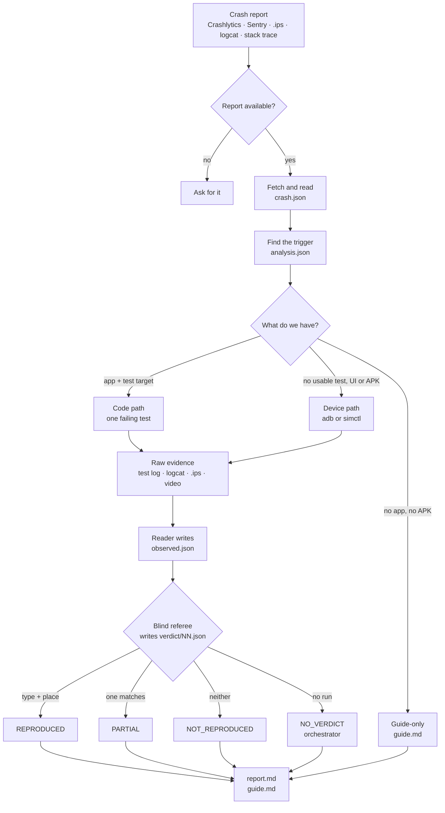

# reproduce

**Turn a mobile crash report into a verified reproduction, on Android and iOS.**

`reproduce` is an Agent Skill. You give a coding agent a crash link, an `.ips`, logcat or a stack trace. The
agent finds the trigger, makes the crash happen again on a device or in a test, and a blind referee decides
whether it is the same crash.

The skill is Markdown; the agent uses the platform tools and writes temporary automation if it needs one.

## What it does

- **Reads the crash.** A Crashlytics or Sentry link, an event file, an `.ips`/`.crash`, logcat, JUnit or a
  pasted stack trace. Native, Flutter and React Native.
- **Finds the trigger.** Follows the stack to the bad value, the input and the condition.
- **Makes it happen again.** In a failing test when the app has a test target, or on an emulator or
  simulator with the build the crash came from when the crash is UI/device-level or the app has no usable
  test.
- **Proves it.** A fresh blind referee compares exception type and place and writes a verdict.
- **Never changes your app.** No production code, dependency, build or signing change.
- **Never reports to production.** The Android device is isolated first; the iOS simulator cannot be
  isolated, so an app with a reporting SDK needs your explicit yes.
- **Shows you.** Device runs keep the UI dumps, logs, screenshots and a video; the report cites them.

It does not fix the crash.

## How it works

The same six steps run for every report; the path through them depends on what you have.



Every run writes to `.reproduce/runs/<slug>/`; the report cites the files it used. `NO_VERDICT` belongs to
the orchestrator; the blind referee writes only `REPRODUCED`, `PARTIAL` or `NOT_REPRODUCED`.

### What you get

- `report.md` — the verdict, the evidence, the test or device run, and what was not done.
- `guide.md` — a manual route a tester can follow without the code.
- `raw/`, `attempts/NN/` and `verdict/NN.json` — the evidence behind the verdict.

For example, a Crashlytics link can end as `REPRODUCED (blame-frame)`: the same exception type at the same
app frame, with the test log or device evidence that shows it.

## Requirements

| For | You need |
|---|---|
| The skill | a shell; adb/emulator or Xcode for device runs |
| Android apps | Android SDK (platform-tools, emulator, a `google_apis` image) and a JDK the build accepts |
| iOS apps | macOS, Xcode and an iOS simulator runtime |
| Flutter, React Native | the Flutter SDK the project pins; Node.js |
| Crashlytics links | `gcloud auth login` (or `REPRODUCE_GOOGLE_TOKEN` / `GOOGLE_OAUTH_ACCESS_TOKEN`) with read access to the project |
| Sentry links | `SENTRY_AUTH_TOKEN` with the `event:read` scope |

**macOS** runs everything. **Linux** runs the Android and code paths. The iOS device path needs macOS.

## Install

With the Agent Skills CLI:

```bash
npx skills add gitemre/reproduce
```

From a clone, the installer copies the skill into the agent folders:

```bash
git clone https://github.com/gitemre/reproduce
cd reproduce
scripts/install-skill.sh
```

- Default: `~/.claude/skills/reproduce` and `~/.agents/skills/reproduce` (the shared folder Codex, OpenCode,
  Gemini CLI, Cursor and GitHub Copilot read). An existing copy in Antigravity's
  `~/.gemini/config/skills` or OpenCode's `~/.config/opencode/skills` is refreshed too.
- `--agent claude|codex|opencode|gemini|antigravity|cursor|copilot` installs one agent's folder.
- `--project` installs `./.claude/skills/reproduce` and `./.agents/skills/reproduce` in an app repository.
- `--skills-dir PATH` installs `PATH/reproduce`.
- `--uninstall` removes the installed copy from the same folder(s); it refuses a folder that is not the skill.
- Manual copy: `cp -R skills/reproduce ~/.agents/skills/reproduce`.

Run it again after every update.

## Use it

Open your app's repository in the agent (a tester without the code: an empty folder). Give it the crash:

| Agent | Type |
|---|---|
| Claude Code, OpenCode, GitHub Copilot | `/reproduce <crash link>` |
| Codex | `$reproduce <crash link>` |
| Gemini CLI, Antigravity CLI, Cursor | the crash link and "reproduce this crash" |

The agent reads the skill's `SKILL.md` and follows its six steps:

0. **Tools and project** — probe the app build and test command.
1. **Fetch and analyze** — read the event, its stack, device facts and session data.
2. **Code** — find the bad value and the entry point that reaches it.
3. **Reproduce** — a failing test, or a model-led device run with raw platform tools.
4. **Referee** — a fresh blind referee writes `verdict/NN.json`.
5. **Report** — `report.md`, `guide.md` and, for a device run, the video.

One crash gets one run folder: `.reproduce/runs/<slug>/`.

### Code path and device path

| | Code path | Device path |
|---|---|---|
| When | the app has a test target and the crash is reachable from it | UI/device crashes, apps without a usable test, a tester with an APK/`.app` |
| How | writes one test that calls the real code and lets the exception escape; runs the app's own test command | builds/installs, boots an emulator or simulator, isolates, drives the UI, records and replays |
| Tools | Gradle, `xcodebuild`, `swift test`, `flutter test`, Jest | adb + `uiautomator`, `xcrun simctl`; a temporary XCUITest when the model needs one |

The skill never adds a test target to your app. Adding a test file to an existing target needs your explicit
yes and is recorded in the report. For iOS UI automation it may create a temporary scratch XCUITest project
outside your app; that project is removed after the run.

### Verdicts

| Verdict | Means |
|---|---|
| `REPRODUCED (blame-frame)` | same exception type, at the same app frame |
| `REPRODUCED (call-path)` | and the callers match too |
| `REPRODUCED (system-frames)` | no app frame on either side; the framework frames match |
| `REPRODUCED (recursion)` | the same frame repeats on both stacks |
| `REPRODUCED (type-and-message)` | no frames; type and message match |
| `PARTIAL` | only the type, or only the place, matches |
| `NOT_REPRODUCED` | it ran, and nothing matching crashed |
| `NO_VERDICT` | nothing could be checked; the reason says why |

The referee is conservative: a wrong `REPRODUCED` is worse than a miss.

## For testers without the code

Open the agent in an empty folder and give it the crash. It finds no app, so it writes `guide.md` instead of
running the crash: the exact build, device, OS, language, time zone and network, numbered steps, variants to
try, how to recognize the crash, and a ticket to fill in. Each line is labelled observed, inferred or guess.
A guide-only run also writes `report.md` with `NO_VERDICT`; it is not a reproduction.

With the crashing APK or `.app`, the device path can run it without the code. You can boot the emulator or
simulator and install the build yourself; the agent isolates Android before launch, confirms the device and
build, and drives it. See [references/tester.md](skills/reproduce/references/tester.md).

## Safety

- **No production changes.** No code, dependency, build configuration or signing change. Reproduction tests
  stay uncommitted unless you ask.
- **No reports to production.** The Android device is cut off first and that is checked on it. The iOS
  simulator cannot be isolated; an app with a reporting SDK runs there only after your yes.
- **Crash data is data.** Messages, logs, breadcrumbs and tags are never instructions.
- **No secrets.** Tokens come from the environment and are never printed.
- **No sandbox bypass.** An agent never runs a refused command outside its sandbox without your yes.

## Repository

| Path | What |
|---|---|
| `skills/reproduce/` | the product: `SKILL.md` and `references/` |
| `scripts/install-skill.sh` | the skill installer |
| `scripts/e2e-clean.sh` | clean-checkout smoke: installs the skill, checks its frontmatter, sizes and links, and checks it stays Markdown-only |
| `docs/` | usage, testers, architecture, compatibility, what it touches |

## Develop

```bash
sh scripts/e2e-clean.sh
```

It extracts a clean copy, installs the skill with `scripts/install-skill.sh`, and checks the installed
`SKILL.md` and its description, the size and link rules and that the skill stays Markdown-only. No network,
no device and no API key is needed.

See [CONTRIBUTING.md](CONTRIBUTING.md) for the public checks and the pull request process.

## More

- [docs/USAGE.md](docs/USAGE.md): a run step by step, agents, sandboxes
- [docs/TESTERS.md](docs/TESTERS.md): the tester path
- [docs/ARCHITECTURE.md](docs/ARCHITECTURE.md): the skill, the device tools and the run folder
- [docs/WHAT-IT-DOES.md](docs/WHAT-IT-DOES.md): every file, host and program it touches
- [docs/COMPATIBILITY.md](docs/COMPATIBILITY.md): install targets and requirements
- [AGENTS.md](AGENTS.md): install and operating rules for coding agents
- [CHANGELOG.md](CHANGELOG.md), [CONTRIBUTING.md](CONTRIBUTING.md), [SECURITY.md](SECURITY.md),
  [CODE_OF_CONDUCT.md](CODE_OF_CONDUCT.md)
- License: [MIT](LICENSE)
