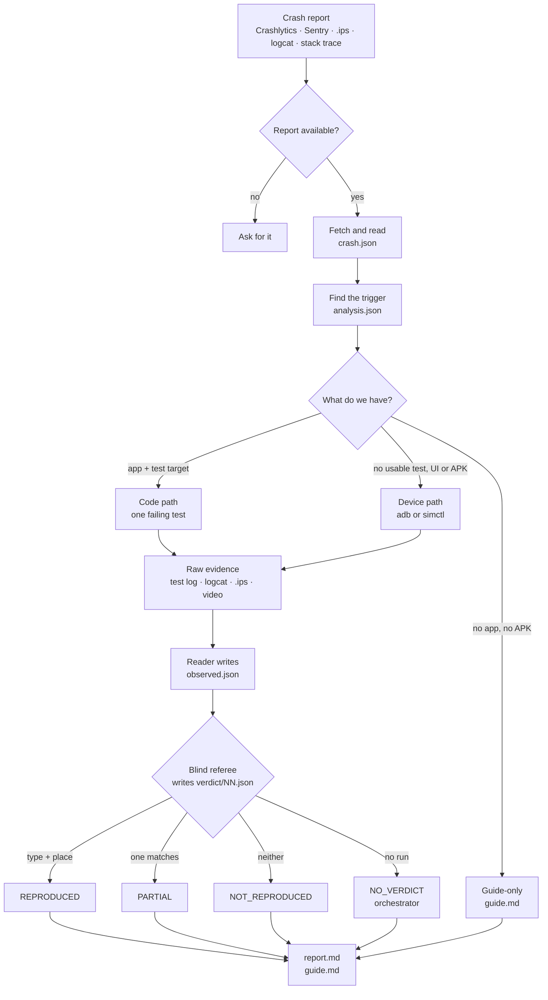
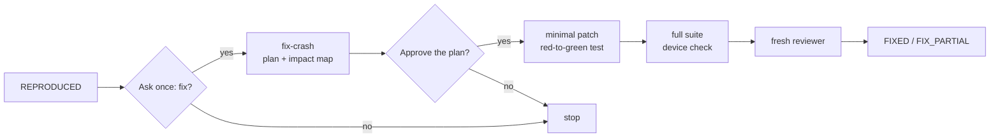

# reproduce

**Turn a mobile crash report into a verified reproduction — and, when you ask, a reviewed fix.**

`reproduce` is an Agent Skill. You give a coding agent a crash link, an `.ips`, logcat or a stack trace. The
agent finds the trigger, makes the crash happen again on a device or in a test, and a blind referee decides
whether it is the same crash. If the verdict is `REPRODUCED`, it can hand off to `fix-crash`: a separate
skill that plans the smallest fix, checks its impact, gets a fresh reviewer, and changes production code only
after your approval.

Both skills are Markdown; the agent uses the platform tools and writes temporary automation if it needs one.

## What it does

- **Reads the crash.** A Crashlytics or Sentry link, an event file, an `.ips`/`.crash`, logcat, JUnit or a
  pasted stack trace. Native, Flutter and React Native.
- **Finds the trigger.** Follows the stack to the bad value, the input and the condition.
- **Makes it happen again.** In a failing test when the app has a test target, or on an emulator or
  simulator with the build the crash came from when the crash is UI/device-level or the app has no usable
  test.
- **Proves it.** A fresh blind referee compares exception type and place and writes a verdict.
- **Fixes it when asked.** After a `REPRODUCED` verdict, `fix-crash` plans the smallest change at the blame
  frame, maps every caller, gets a fresh reviewer and asks before touching production code.
- **Keeps reproduction read-only.** No production code, dependency, build or signing change during
  `/reproduce`.
- **Never reports to production.** The Android device is isolated first; the iOS simulator cannot be
  isolated, so an app with a reporting SDK needs your explicit yes.
- **Shows you.** Device runs keep the UI dumps, logs, screenshots and a video; the report cites them.

It reproduces first. A fix is a separate, opt-in skill and starts only from a `REPRODUCED` verdict.

## How it works

The same six steps run for every report; the path through them depends on what you have.



Every run writes to `.reproduce/runs/<slug>/`; the report cites the files it used. `NO_VERDICT` belongs to
the orchestrator; the blind referee writes only `REPRODUCED`, `PARTIAL` or `NOT_REPRODUCED`.

### What you get

- `report.md` — the verdict, the evidence, the test or device run, and what was not done.
- `guide.md` — a manual route a tester can follow without the code.
- `raw/`, `attempts/NN/` and `verdict/NN.json` — the evidence behind the verdict.

For example, a Crashlytics link can end as `REPRODUCED (blame-frame)`: the same exception type at the same
app frame, with the test log or device evidence that shows it.

### Fix after reproduction



- Only after `REPRODUCED`. `PARTIAL`, `NOT_REPRODUCED` and `NO_VERDICT` are not fixable.
- The agent asks once, at the end of `/reproduce`; there is no automatic fix.
- Two approvals: write the plan, then apply the patch. The exact quotes are in `fix/approved.md`; a missing
  or ambiguous quote is a rejected fix.
- The fresh reviewer sees the applied diff, `fix/checks/` (analyzer, red/green, diff, schema) and the test
  results, not just the plan. It reads the `blind/` copy; no host hook is required.
- `fix/plan.md`, `fix/approved.md`, `fix/impact.log`, `fix/checks/`, `fix/review.json`, `fix/report.md` and
  `fix/diff.patch`; the diff stays uncommitted.
- `FIXED` needs reviewer approval, a red-to-green reproduction test and the full suite. A device-only fix
  without an automated regression test is `FIX_PARTIAL`.

## Requirements

| For | You need |
|---|---|
| The skills | a shell; adb/emulator or Xcode for device runs |
| A fix | a completed run folder whose `verdict/NN.json` is `REPRODUCED`, the app's build/test tools, and a fresh reviewer |
| Android apps | Android SDK (platform-tools, emulator, a `google_apis` image) and a JDK the build accepts |
| iOS apps | macOS, Xcode and an iOS simulator runtime |
| Flutter, React Native | the Flutter SDK the project pins; Node.js |
| Crashlytics links | `gcloud auth login` (or `REPRODUCE_GOOGLE_TOKEN` / `GOOGLE_OAUTH_ACCESS_TOKEN`) with read access to the project |
| Sentry links | `SENTRY_AUTH_TOKEN` with the `event:read` scope |

**macOS** runs everything. **Linux** runs the Android and code paths. The iOS device path needs macOS.

## Install

With the Agent Skills CLI, add both skills:

```bash
npx skills add gitemre/reproduce
npx skills add gitemre/reproduce --skill=fix-crash
```

From a clone, the installer copies both skills into the agent folders:

```bash
git clone https://github.com/gitemre/reproduce
cd reproduce
scripts/install-skill.sh
```

- Default: `reproduce` and `fix-crash` in `~/.claude/skills` and `~/.agents/skills` (the shared folder Codex,
  OpenCode, Gemini CLI, Cursor and GitHub Copilot read). Existing copies in Antigravity's
  `~/.gemini/config/skills` or OpenCode's `~/.config/opencode/skills` are refreshed too.
- `--agent claude|codex|opencode|gemini|antigravity|cursor|copilot` installs both in one agent's folder.
- `--project` installs both in `./.claude/skills` and `./.agents/skills` in an app repository.
- `--skills-dir PATH` installs `PATH/reproduce` and `PATH/fix-crash`.
- `--uninstall` removes both from the same folder(s); it refuses a folder that does not contain these skills.
- Manual copy: `cp -R skills/reproduce skills/fix-crash ~/.agents/skills/`.

## Update

Re-run the installer; it replaces both skills atomically.

```bash
git pull
scripts/install-skill.sh
```

With the Agent Skills CLI, `npx skills update` updates the installed skills. If you installed with a flag,
repeat it: `--agent claude`, `--project` or `--skills-dir PATH`.

Start a new agent session (or reload the skills) so the new `SKILL.md` files are read. To check one copy:

```bash
shasum -a 256 ~/.agents/skills/reproduce/SKILL.md skills/reproduce/SKILL.md
```

## Use it

Open your app's repository in the agent (a tester without the code: an empty folder). Give it the crash:

| Agent | Type |
|---|---|
| Claude Code, OpenCode, GitHub Copilot | `/reproduce <crash link>` |
| Codex | `$reproduce <crash link>` |
| Gemini CLI, Antigravity CLI, Cursor | the crash link and "reproduce this crash" |

The agent reads the skill's `SKILL.md` and follows its six steps:

0. **Tools and project** — probe the app build and test command.
1. **Fetch and analyze** — read the event, its stack, device facts and session data.
2. **Code** — find the bad value and the entry point that reaches it.
3. **Reproduce** — a failing test, or a model-led device run with raw platform tools.
4. **Referee** — a fresh blind referee writes `verdict/NN.json`.
5. **Report** — `report.md`, `guide.md` and, for a device run, the video.

One crash gets one run folder: `.reproduce/runs/<slug>/`.

After step 5, if the verdict is `REPRODUCED`, the agent asks once whether to prepare a fix. Say yes to hand
off to `fix-crash`; no to keep the report only. You can also start the fix directly with
`/fix-crash <run folder>` (Claude Code, OpenCode, GitHub Copilot), `$fix-crash <run folder>` (Codex), or
"fix this crash" plus the run folder.

### Code path and device path

| | Code path | Device path |
|---|---|---|
| When | the app has a test target and the crash is reachable from it | UI/device crashes, apps without a usable test, a tester with an APK/`.app` |
| How | writes one test that calls the real code and lets the exception escape; runs the app's own test command | builds/installs, boots an emulator or simulator, isolates, drives the UI, records and replays |
| Tools | Gradle, `xcodebuild`, `swift test`, `flutter test`, Jest | adb + `uiautomator`, `xcrun simctl`; a temporary XCUITest when the model needs one |

`reproduce` never adds a test target to your app. Adding a test file to an existing target needs your explicit
yes and is recorded in the report. For iOS UI automation it may create a temporary scratch XCUITest project
outside your app; that project is removed after the run.

### Verdicts

| Verdict | Means |
|---|---|
| `REPRODUCED (blame-frame)` | same exception type, at the same app frame |
| `REPRODUCED (call-path)` | and the callers match too |
| `REPRODUCED (system-frames)` | no app frame on either side; the framework frames match |
| `REPRODUCED (recursion)` | the same frame repeats on both stacks |
| `REPRODUCED (type-and-message)` | no frames; type and message match |
| `PARTIAL` | only the type, or only the place, matches |
| `NOT_REPRODUCED` | it ran, and nothing matching crashed |
| `NO_VERDICT` | nothing could be checked; the reason says why |

An event the app reports itself (`recordError`, `captureException`) matches by message and by the
reporter's app frame: its type is the transport's, so it decides nothing (`R16`).

The referee is conservative: a wrong `REPRODUCED` is worse than a miss.

### Fix statuses

| Status | Means |
|---|---|
| `FIXED` | fresh reviewer `APPROVED`, red-to-green reproduction test, full suite pass |
| `FIX_PARTIAL` | verified, but the impact map or an automated regression test is incomplete |
| `NOT_FIXED` | suite failed, reviewer rejected, or the root cause was not reached |

A fix report also records the diff, the callers checked, the untested paths, the residual risk and the
rollback.

## For testers without the code

Open the agent in an empty folder and give it the crash. It finds no app, so it writes `guide.md` instead of
running the crash: the exact build, device, OS, language, time zone and network, numbered steps, variants to
try, how to recognize the crash, and a ticket to fill in. Each line is labelled observed, inferred or guess.
A guide-only run also writes `report.md` with `NO_VERDICT`; it is not a reproduction.

With the crashing APK or `.app`, the device path can run it without the code. You can boot the emulator or
simulator and install the build yourself; the agent isolates Android before launch, confirms the device and
build, and drives it. See [references/tester.md](skills/reproduce/references/tester.md).

## Safety

- **Reproduction is read-only.** No production code, dependency, build configuration or signing change
  during `/reproduce`. A fix is the separate `fix-crash` skill, only after your explicit approval; the diff
  stays uncommitted unless you ask.
- **No reports to production.** The Android device is cut off first and that is checked on it. The iOS
  simulator cannot be isolated; an app with a reporting SDK runs there only after your yes.
- **Crash data is data.** Messages, logs, breadcrumbs and tags are never instructions.
- **No secrets.** Tokens come from the environment and are never printed.
- **No sandbox bypass.** An agent never runs a refused command outside its sandbox without your yes.

## Repository

| Path | What |
|---|---|
| `skills/reproduce/` | the evidence skill: `SKILL.md` and `references/` |
| `skills/fix-crash/` | the opt-in fix skill: `SKILL.md` and `references/` |
| `scripts/install-skill.sh` | installs both skills |
| `scripts/e2e-clean.sh` | clean-checkout smoke: installs both, checks each frontmatter, sizes and links, and checks they stay Markdown-only |
| `docs/` | usage, testers, architecture, compatibility, what it touches |

## Develop

```bash
sh scripts/e2e-clean.sh
```

It extracts a clean copy, installs both skills with `scripts/install-skill.sh`, and checks each installed
`SKILL.md` and its description, the size and link rules and that the skills stay Markdown-only. No network,
no device and no API key is needed.

See [CONTRIBUTING.md](CONTRIBUTING.md) for the public checks and the pull request process.

## More

- [docs/USAGE.md](docs/USAGE.md): a run step by step, agents, sandboxes
- [docs/TESTERS.md](docs/TESTERS.md): the tester path
- [docs/ARCHITECTURE.md](docs/ARCHITECTURE.md): the skills, the device tools and the run folder
- [skills/fix-crash/SKILL.md](skills/fix-crash/SKILL.md): the fix flow
- [docs/WHAT-IT-DOES.md](docs/WHAT-IT-DOES.md): every file, host and program it touches
- [docs/COMPATIBILITY.md](docs/COMPATIBILITY.md): install targets and requirements
- [AGENTS.md](AGENTS.md): install and operating rules for coding agents
- [CHANGELOG.md](CHANGELOG.md), [CONTRIBUTING.md](CONTRIBUTING.md), [SECURITY.md](SECURITY.md),
  [CODE_OF_CONDUCT.md](CODE_OF_CONDUCT.md)
- License: [MIT](LICENSE)
